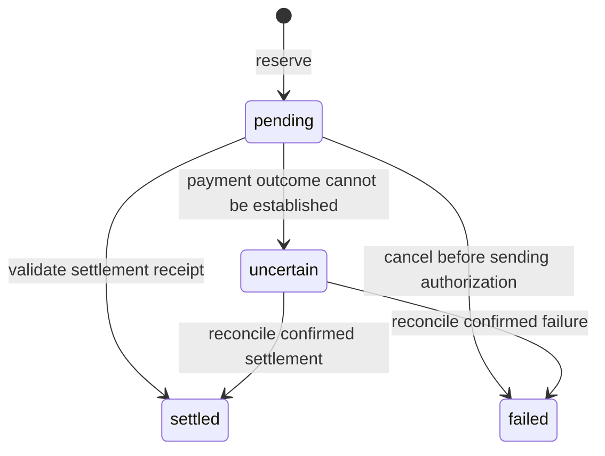

# Payment lifecycle

A buyer first requests a resource without payment. If the provider returns an
x402 challenge, the buyer selects an offer and checks its recipient, network,
asset, amount, and origin against the configured spend policy.

Before signing, the buyer reserves the amount in a durable ledger. The reservation
checks both daily and total limits inside one database transaction. Policy checks
alone cannot protect a budget when several processes spend at the same time.

## Reservation ownership

`Ledger.reserve_once` returns a reservation and a `created` flag. Only the caller
that created the reservation may produce a new authorization. An existing request
ID identifies an earlier attempt, including attempts that failed or became
uncertain. Reusing that ID must not create a second authorization.

The reservation fingerprint binds the request ID to the payment and request
context. Currency buckets include the network and asset identity. Contract assets
use their contract address so two tokens with the same display code cannot share
an accounting bucket.

## Outcomes

Pending, uncertain, and settled entries count against the total budget. Failed
entries do not. Daily limits use the UTC date of the reservation. A transport
failure after sending an authorization cannot prove that payment failed, so the
reservation remains counted until reconciliation establishes the outcome.

A successful provider response reports settlement through `PAYMENT-RESPONSE`.
That receipt is the provider's assertion. Applications that need independent
confirmation should reconcile its transaction identifier against the network.

## Provider boundary

The provider compares the submitted offer with its current route requirements,
verifies the authorization through its configured facilitator, and settles before
releasing protected content. This upfront payment order means a handler can fail
after settlement; an application needs its own refund or support policy for that
case.

Replay protection must identify the underlying authorization, not its JSON
encoding or the transaction envelope alone. Stellar authorization entries can be
placed in different envelopes. Provider instances protecting the same payment
recipient should share persistent replay state.

The local demo uses a separate payment scheme and HMAC authorization. Its receipts
represent local test activity. Stellar settlement uses the facilitator and network
configured by the application.
